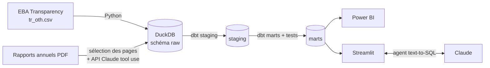

# 🏦 Bank Insight

**Benchmark des grandes banques européennes : des rapports annuels lus par l'IA, contrôlés contre les données officielles de l'EBA.**

Les rapports annuels des banques font plus de 500 pages. Bank Insight en extrait automatiquement les indicateurs clés (solvabilité, rentabilité, coût du risque) avec l'API Claude, **vérifie chaque chiffre** contre les données réglementaires de l'Autorité bancaire européenne, puis les expose dans un tableau de bord Power BI et un assistant conversationnel.

> 📊 *Résultat clé (à compléter) : XX % des ratios extraits par Claude concordent avec les données EBA ; l'agent text-to-SQL répond correctement à XX % des 30 questions de référence.*

## Architecture



| Étape | Outil | Fichier |
|---|---|---|
| Téléchargement des données EBA | Python, requests | `src/ingestion/download_eba.py` |
| Chargement dans l'entrepôt | DuckDB | `src/ingestion/load_eba.py` |
| Extraction des KPI depuis les PDF | **API Claude** (document + tool use forcé) | `src/extraction/extract_kpis.py` |
| Modélisation et tests qualité | **dbt** | `dbt/models/` · `dbt/tests/` |
| Contrôle Claude vs EBA | dbt | `dbt/models/marts/mart_extraction_quality.sql` |
| Assistant en langage naturel | **Claude** + outil `run_sql` | `src/agent/sql_agent.py` |
| Démonstration | Streamlit | `app/streamlit_app.py` |
| Évaluation de l'agent | Python | `evals/` |
| Intégration continue | GitHub Actions | `.github/workflows/ci.yml` |

## Choix techniques (à savoir expliquer en entretien)

- **Pas de chiffre sans source.** Claude doit renvoyer pour chaque KPI la page et une citation exacte ; un test dbt (`assert_values_have_source`) bloque toute valeur sans traçabilité.
- **Sortie structurée imposée.** L'extraction passe par un outil `record_kpis` avec `tool_choice` forcé : la réponse est toujours un JSON conforme au schéma, jamais du texte libre.
- **Pré-sélection des pages.** On n'envoie que les ~30 pages contenant les mots-clés des KPI : coût divisé par ~15 et limite de pages de l'API respectée.
- **Contrôle par une source indépendante.** Les ratios réglementaires (CET1, solvabilité globale, levier) sont comparés aux données EBA, avec une tolérance de 0,15 point.
- **Garde-fous métier.** Un CET1 hors de [5 % ; 40 %] est presque toujours une erreur d'unité : test `assert_ratios_plausible`.
- **Agent en lecture seule.** Connexion DuckDB `read_only`, requêtes `SELECT`/`WITH` uniquement, 6 appels maximum par question.

## Démarrage

```bash
git clone https://github.com/<ton-compte>/bank-insight.git && cd bank-insight
python -m venv .venv && source .venv/bin/activate      # Windows : .venv\Scripts\activate
pip install -r requirements.txt
cp .env.example .env                                     # puis renseigne ANTHROPIC_API_KEY
```

1. **Données EBA**
   ```bash
   python -m src.ingestion.download_eba
   python -m src.ingestion.load_eba
   ```
2. **Correspondance des codes EBA** : cherche les codes des ratios et reporte-les dans `dbt/seeds/eba_item_mapping.csv`.
   ```bash
   python -m src.ingestion.load_eba --search cet1
   python -m src.ingestion.load_eba --search leverage
   ```
3. **Rapports annuels** : télécharge le document d'enregistrement universel 2024 de chaque banque (espace « Investisseurs » de leur site) dans `data/raw/reports/`, avec le nom indiqué dans `config/banks.yaml`. Commence avec 2 ou 3 banques.
4. **Extraction par Claude**
   ```bash
   python -m src.extraction.extract_kpis --bank "BNP"     # tester sur une banque
   python -m src.extraction.extract_kpis                  # puis toutes
   ```
5. **Modélisation et tests**
   ```bash
   cd dbt && dbt build --profiles-dir . && cd ..
   ```
6. **Application et évaluation**
   ```bash
   streamlit run app/streamlit_app.py
   python -m evals.run_evals
   ```
7. **Power BI** : connecte Power BI au fichier `data/bank_insight.duckdb` (connecteur ODBC DuckDB) ou exporte `marts.mart_bank_benchmark` en CSV/Parquet.

## Feuille de route

- [ ] Semaine 1 : données EBA chargées, codes Item identifiés
- [ ] Semaine 2 : extraction sur 3 banques, revue manuelle des résultats
- [ ] Semaine 3 : 10 banques, modèles et tests dbt au vert, taux de concordance mesuré
- [ ] Semaine 4 : dashboard Power BI (benchmark, fiabilité, fiches banque)
- [ ] Semaine 5 : agent text-to-SQL, 30 questions d'évaluation, itérations sur le prompt
- [ ] Semaine 6 : app Streamlit déployée, vidéo de 2 min, post LinkedIn
- [ ] Bonus : historique sur 3 exercices, données Pillar 3 Data Hub de l'EBA, serveur MCP sur l'entrepôt

## Sources de données

- [EBA, EU-wide transparency exercise](https://www.eba.europa.eu/risk-and-data-analysis/risk-analysis/eu-wide-transparency-exercise) : 119 banques, dates de référence de sept. 2024 à juin 2025.
- Rapports annuels / documents d'enregistrement universels publiés par chaque banque.

---
Projet personnel de Mourad Saizonou, Data Analyst.
